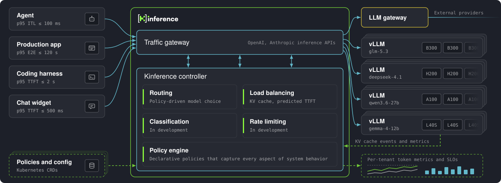

<p align="center">
  <picture>
    <source media="(prefers-color-scheme: dark)" srcset="docs/assets/kinference-logo-dark.svg">
    
  </picture>
</p>

<h3 align="center">The inference control plane for Kubernetes and vLLM</h3>

<p align="center">
  <a href="https://github.com/Kinference-AI/kinference-releases/releases"></a>
  <a href="LICENSE"></a>
  <a href="https://kinference.ai/docs/"></a>
  <a href="https://github.com/Kinference-AI/kinference/discussions"></a>
</p>

<p align="center">
  <a href="https://kinference.ai/docs/getting-started/"><b>Get started</b></a> ·
  <a href="https://kinference.ai/docs/"><b>Docs</b></a> ·
  <a href="ARCHITECTURE.md"><b>Architecture</b></a> ·
  <a href="#benchmarks"><b>Benchmarks</b></a> ·
  <a href="https://github.com/Kinference-AI/kinference/discussions"><b>Discussions</b></a> ·
  <a href="CONTRIBUTING.md"><b>Contributing</b></a>
</p>

# [K]inference

🎈 Welcome to [K]inference! 👋

[K]inference is an inference _control plane_ for Kubernetes and vLLM. The name is pronounced "kay-inference", and you can write it as `[K]inference` or `Kinference`.

At its core, Kinference handles routing, load balancing, prompt classification, and other actions for serving inference, all through declarative policies. It's designed to be paired with a proxy such as the [Buoyant Gateway](https://github.com/BuoyantIO/gateway/).

You can deploy any type of model with vLLM, on whatever GPUs and servers you have. Kinference puts a single OpenAI- and Anthropic-compatible endpoint in front of those vLLM workers, sends each request to the worker it predicts will answer fastest, and applies the routing policies you declare.

## What you can do with [K]inference

Kinference is for platform teams that run models on their own GPUs. Your application teams point their clients at one endpoint and don't change any code.

- **Get more out of your GPUs.** Each request goes to the worker that will answer fastest, which is usually the one that already has the prompt in its key-value (KV) cache.
- **See who is using what.** You get time to first token (TTFT), inter-token latency (ITL), and total latency for every request, by model, tenant, and quality-of-service (QoS) class. The chart includes a Grafana dashboard.
- **Burst to the cloud.** When your workers are backed up, a policy sends the overflow to a hosted provider.
- **Run coding agents on your own hardware.** Agents tend to resend the same files over and over, which is where cache-aware routing helps most. OpenAI and Anthropic clients both work.
- **Route by prompt.** Let a smaller model take the simple prompts. The classifiers for this are still in development.

## What's available today

| Capability | What it does | Status |
|------------|--------------|--------|
| KV-cache-aware load balancing | Sends each request to the worker with the lowest predicted TTFT, based on what each worker has cached and how busy it is. | Available |
| Inference policies | `InferencePolicy` rules match requests by model, tenant, QoS class, and token counts, then narrow and rank the endpoints. | Available |
| Model aliases | Short names for models, like `gemma-4` for `google/gemma-4-12B-it`. | Available |
| External providers | Fall back from local workers to a provider outside the cluster. | Available |
| OpenAI and Anthropic APIs | Chat completions and Messages requests both work. | Available |
| Inference metrics | Prometheus metrics for TTFT, ITL, request duration, and token counts, by model, tenant, and QoS class. | Available |
| Offline policy checks | `kinfctl check` catches policy mistakes without a cluster. | Available |
| Token rate limiting | Per-tenant token limits. | In development |
| Semantic classifiers | Tags that a policy can match, like prompt complexity or personally identifiable information (PII). | In development |
| Multiple replicas | More than 1 Kinference replica behind the gateway. | In development |

## Benchmarks

We ran Kinference against a plain Kubernetes Service in front of the same vLLM deployment. Each setup had 3 vLLM pods, each on 1 L40S GPU, serving Qwen-3.8-27B-FP8, with GuideLLM generating the load.

| Result | Workload | Kubernetes Service | Kinference |
|--------|----------|--------------------|------------|
| **95% lower** median TTFT | Shared prefix, light load | 6.88 s | 0.31 s |
| **65% lower** median TTFT | Multi-turn, light load | 1.70 s | 0.59 s |
| **7.4× higher** peak goodput | Shared prefix, under load | 14.0 req/min | 103.0 req/min |
| **3.5× higher** peak goodput | Multi-turn, under load | 23.8 req/min | 82.7 req/min |
| **No added latency** at the median | No shared prefix, light load | 6.92 s | 6.83 s |

Goodput is the number of requests per minute that met the latency objective. The absolute numbers depend on the model and the hardware, so read the 2 columns against each other. The [detailed benchmark write-up, on the Buoyant blog](https://www.buoyant.io/blog/distributed-inference-benchmarks-kinference-vs-plain-kubernetes) has more information on the benchmarking setup, methodology, the confidence intervals and the full results.

## How it works

<p align="center">
  
</p>

The gateway streams each request body to Kinference over gRPC and asks where to send it. Kinference watches every vLLM worker's KV-cache events and engine metrics, so it can tokenize the prompt, check which workers already have its prefix cached, and predict how long each one would take to respond. If the request names an `InferencePool`, that pool's `InferencePolicy` narrows and ranks the candidates first, and the pick may be a provider outside the cluster. Kinference returns the endpoint it picked, along with the appropriately mutated body.

Kinference currently uses NVIDIA's [dynamo-kv-router](https://github.com/ai-dynamo/dynamo) crate to handle cache events. [ARCHITECTURE.md](ARCHITECTURE.md) is the map of the code, and [docs/request-flow.md](docs/request-flow.md) follows one request step by step.

## Example policy

This `InferencePolicy` keeps requests on your local workers while they have room, and bursts to a provider when they don't.

```yaml
apiVersion: kinference.buoyant.io/v1alpha1
kind: InferencePolicy
metadata: { name: burst-policy, namespace: inference }
spec:
  rules:
  - name: burst-to-cloud
    route:
      exclude:
      - name: drop-overloaded-workers
        drop:
          backend:       { type: Local }
          queuedPrompts: { greaterThan: 2 }
      select:
      - { type: Local,    minimize: PredictedTTFT }
      - { type: Provider, order: [bedrock, databricks] }
```

Any local worker that averaged more than 2 queued prompts over the last 30 seconds is dropped. The request goes to whichever local worker is left with the lowest predicted TTFT. If none are left, it goes to a provider, with `bedrock` preferred over `databricks`. The [CRD reference docs](https://kinference.ai/docs/reference/crds/) cover every field.

## Quick start

You'll need a Kubernetes cluster, `kubectl`, and Helm. These commands install the Gateway API Custom Resource Definitions (CRDs), the Buoyant Gateway, and Kinference into the `default` namespace.

```sh
GWAPI_VERSION=1.5.1
kubectl apply --server-side --force-conflicts -f https://github.com/kubernetes-sigs/gateway-api/releases/download/v$GWAPI_VERSION/standard-install.yaml

helm upgrade -i gateway-crds oci://ghcr.io/buoyantio/charts/gateway-crds --devel
helm upgrade -i gateway oci://ghcr.io/buoyantio/charts/gateway --devel --wait

helm upgrade -i kinference-crds oci://cr.kinference.ai/kinference-ai/charts/kinference-crds --devel
helm upgrade -i kinference oci://cr.kinference.ai/kinference-ai/charts/kinference \
  --set extension.enabled=true \
  --devel --wait
```

When they finish, `kubectl get po` shows a `gateway-cp` pod and a `kinference` pod, both `Running`. The [getting started guide](https://kinference.ai/docs/getting-started/) has the full steps, including how to install the CLI and serve your first model.

## CRDs

Kinference is configured mostly through CRDs, and it sets status on them as it runs. The schemas are in [charts/kinference-crds](charts/kinference-crds/templates), and the [CRD reference docs](https://kinference.ai/docs/reference/crds/) describe each one.

| CRD | What it declares |
|-----|------------------|
| `InferenceWorkerSet` | A group of vLLM workers, the models they serve, and those models' aliases. |
| `InferenceProvider` | A destination outside the cluster. |
| `InferencePool` | The destinations a route may reach, and the policy that chooses among them. |
| `InferencePolicy` | The rules that match requests and select an endpoint. |

## kinfctl

This repo includes `kinfctl`, a CLI that makes it easy for you (or your agents) to validate policies before sending them to the server. See [the kinfctl reference](https://kinference.ai/docs/reference/kinfctl/) for more, or run `just install-cli` to build it from source.

## Known limitations

Kinference is alpha software and hasn't seen sustained production exposure, so run it at your own risk.

Rate limiting, semantic classifiers, and support for multiple replicas are in the full scope of the project and still in active development. These features, and others, are coming soon.

## Related projects

Kinference builds on [vLLM](https://github.com/vllm-project/vllm) and on the `dynamo-kv-router` crate from [NVIDIA Dynamo](https://github.com/ai-dynamo/dynamo), and it covers some of the same ground as the [Gateway API Inference Extension](https://github.com/kubernetes-sigs/gateway-api-inference-extension). [docs/prior-art.md](docs/prior-art.md) has the full list.

## Documentation

- [Getting started](https://kinference.ai/docs/getting-started/): How to install Kinference on a cluster.
- [Architecture](ARCHITECTURE.md): Overall project architecture.
- [Request flow](docs/request-flow.md): How requests flow through the system as a whole.
- [Local development](docs/local-development.md): How to build, install, and run locally.
- [Contributing](CONTRIBUTING.md): How to contribute to the project.

## Community

Please use [GitHub discussions](https://github.com/Kinference-AI/kinference/discussions)!

## Copyright and license

Kinference is copyright 2026 Buoyant, Inc.

Kinference is licensed under the Apache License, Version 2.0. See [LICENSE](LICENSE) for the full text.
